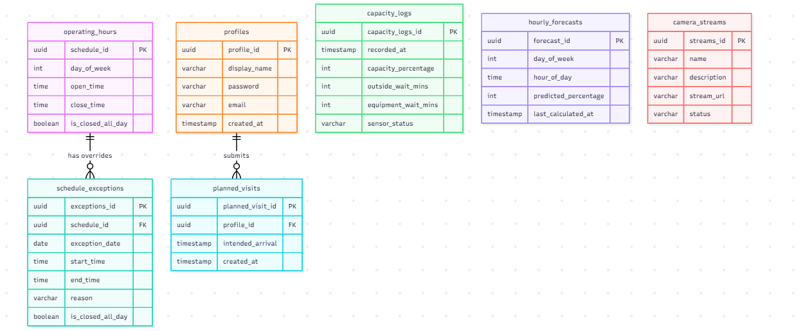

# IS 401 Semester Project

## App Summary:
The BYU Gym Planner solves the daily frustration of arriving at the campus recreation facilities only to find overcrowded weight floors and long lines for equipment. This problem is primarily experienced by BYU students, faculty, and staff trying to fit workouts into tight academic schedules. Our application provides real-time visibility into the gym's status by displaying live capacity percentages, estimated wait times for entry and equipment, and active camera stream statuses. It offers a predictive "Week View" that forecasts the quietest hours based on an 8-week historical rolling average. Finally, users can submit their email address to their profile for future account features.

## ERD

## Stack Description
We plan on using Vanilla HTML, CSS, and JavaScript (No build steps or complex frameworks) for our front end design and combining that with Supabase for our backend database queerying. Additionally, we plan on using Claude for rapid code generation and debugging. This structure fits our team for a couple of reasons. Firstly, by using vanilla HTML, CSS, and JavaScript, our team avoids the steep learning curve and configuration overhead of frameworks like React or Node.js. What we write is exactly what runs in the browser, making debugging and structure transparent. Secondly, using Supabase provides a postgres integrated database that allows our plain Javascript frontend to securely read and write live crowd metrics, wait times, and forecasts directly to the database without needing to build a custom Express/Node server.

## How to Get It Running
1. Clone this repository to your local machine using GitHub Desktop or the terminal: git clone [(https://github.com/Kurtisef/dreamteam.git)]
2. Open the cloned project folder in Visual Studio Code.
3. Locate the index.html file in the file explorer.
4. If you do not have it installed, install the Live Server extension in VS Code.
5. Right-click the index.html file and select "Open with Live Server".
6. The application will automatically open in your default web browser at [http://127.0.0.1:5500](http://127.0.0.1:5500). The Supabase connection is already configured in the code, so live data will populate immediately.

## Verifying the Profile Vertical Slice
To verify that the frontend saves a username and email, then uses both values for the simple passwordless login:

1. Open the application using the Live Server instructions above.
2. Click the "Log in" button.
3. Click "New here? Create a profile".
4. Enter a username and email, then click "Save profile".
5. Log out, enter the same username and email, and click "Log in".
6. In Supabase Table Editor, open `profiles` and confirm that the username was saved in `display_name` and the email was saved in `email`.